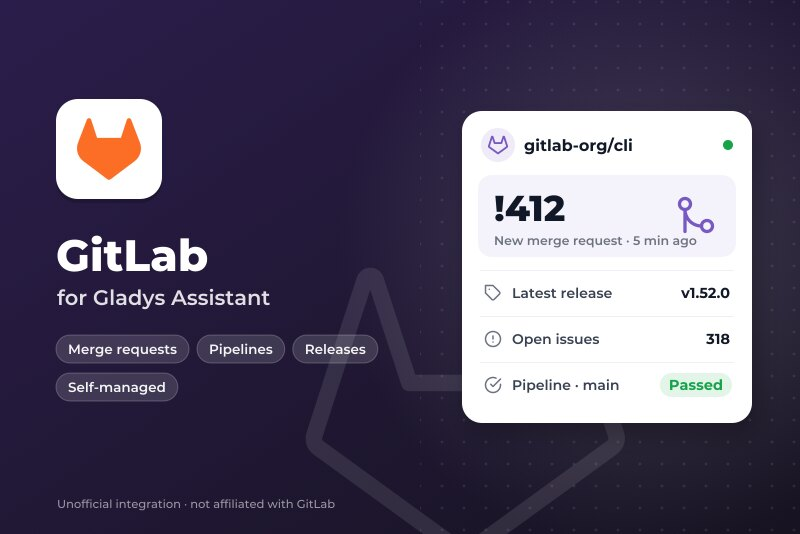
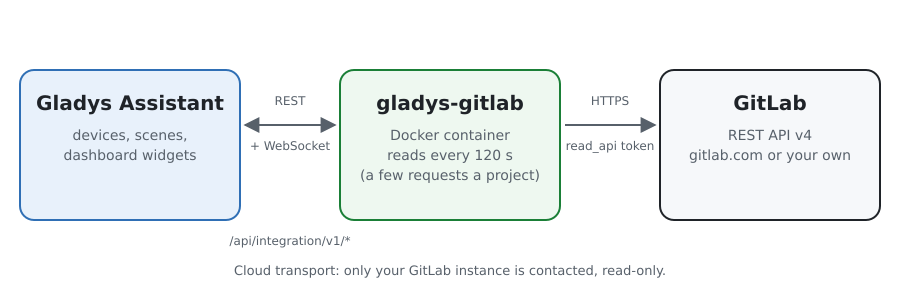
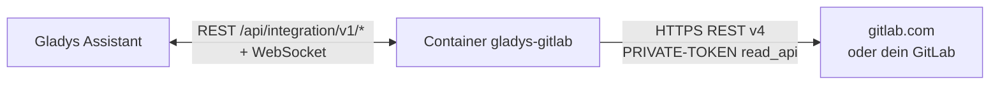
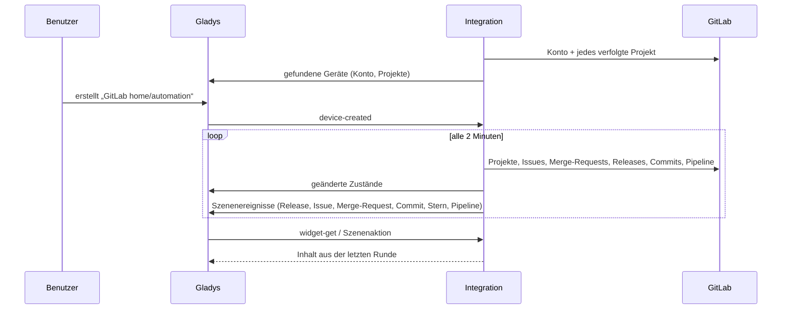
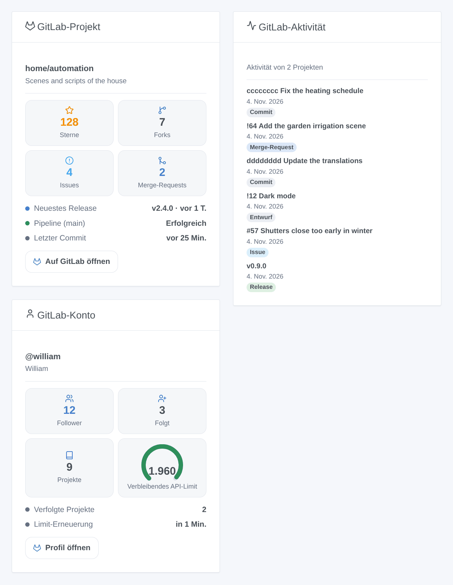
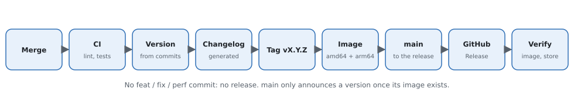

# Gladys GitLab

[English](README.md) · [Français](README.fr.md) · **Deutsch** · [Español](README.es.md)

[](LICENSE)
[](https://github.com/William-De71/gladys-gitlab/releases)
[](https://github.com/William-De71/gladys-gitlab/actions/workflows/release.yml)
[](https://gladysassistant.com)



Externe Integration für [Gladys Assistant](https://gladysassistant.com) für **[GitLab](https://about.gitlab.com)**, auf gitlab.com oder auf deinem eigenen, selbst gehosteten GitLab: Verfolge Projekte in Gladys, ihre Releases, Issues, Merge-Requests, Pipelines und Sterne, in Szenen und auf dem Dashboard. Sie liest die offizielle REST-API v4 von GitLab mit einem Zugriffstoken, nur lesend.

## Funktionen

- **Ein Gerät pro verfolgtem Projekt** (bis zu 30) und **eines für dein Konto**: Sterne, Forks, offene Issues, offene und gemergte Merge-Requests, neuestes Release, Tag, Commit, Issue, Merge-Request und der Zustand der letzten Pipeline des Standard-Branches.
- **6 Szenenauslöser**, **1 Szenenaktion** und **3 Dashboard-Widgets** (unten).
- gitlab.com oder ein **selbst gehostetes GitLab**, unter der Adresse deiner Wahl.
- Die Muster `Gruppe/*` und `Gruppe/Präfix*` verfolgen alle Projekte einer Gruppe (mit Untergruppen) oder eines Benutzers.
- Nur lesend: In GitLab wird nie etwas geschrieben. Eine Schaltfläche der Konfiguration prüft das Token.
- Vier Sprachen überall: Englisch, Französisch, Deutsch, Spanisch.

## Funktionsweise





Standardmäßig alle 2 Minuten (60 bis 3.600 Sekunden) liest die Integration das Konto des Tokens, dann jedes verfolgte Projekt mit einigen kleinen Anfragen: das Projekt, seine neuesten Issues und Merge-Requests, die Anzahl offener und gemergter Merge-Requests (Header `x-total`), seine Releases, den neuesten Tag, die Commits und die letzte Pipeline des Standard-Branches. Jede Runde wird mit der vorherigen verglichen, um die Szenenauslöser auszulösen; die erste Runde ist die Referenz und löst nichts aus. Ein Teil, den ein Projekt nicht hat (Merge-Requests deaktiviert, leeres Repository), wird einfach ausgelassen.



### Transport

Nur Cloud (`"transports": ["cloud"]`): Der Katalog zeigt das Cloud-Abzeichen. Die Integration kontaktiert die gewählte GitLab-Instanz (standardmäßig gitlab.com) über HTTPS mit deinem Token. Ein selbst gehostetes GitLab in deinem Netzwerk wird genauso unter seiner Adresse erreicht; es gibt keine Schaltfläche „Lokale Verbindung bevorzugen“.

## Geräte und Funktionen

| Funktion                               | Kategorie / Typ          | Hinweis                                         |
| -------------------------------------- | ------------------------ | ----------------------------------------------- |
| Sterne, Forks, offene Issues           | `counter-sensor/integer` | Projekt                                         |
| Offene, gemergte Merge-Requests        | `counter-sensor/integer` | Projekt                                         |
| Neuestes Release, Tag, Commit          | `text/text`              | Projekt                                         |
| Neuestes Issue, neuester Merge-Request | `text/text`              | `#57 Titel`, `!64 Titel`                        |
| Pipeline des Standard-Branches         | `text/text`              | Erfolgreich, Fehlgeschlagen, Abgebrochen, Läuft |
| Follower, gefolgt, Projekte            | `counter-sensor/integer` | Konto des Tokens                                |

`should_poll: false`: Die Integration liest GitLab in ihrem eigenen Takt. Die externen IDs beruhen auf den numerischen IDs von GitLab: Ein umbenanntes oder verschobenes Projekt behält sein Gerät. Ein Zähler, den GitLab nicht geliefert hat, wird nicht veröffentlicht, nie auf 0 gesetzt.

## Szenenauslöser, Aktion und Widgets



**Auslöser** (Filter: das Gerät des Projekts)

- **Release veröffentlicht**: Ein verfolgtes Projekt veröffentlicht ein Release (ein kommendes zählt an seinem Datum).
- **Issue geöffnet** und **Merge-Request geöffnet** (mit seinem Merkmal `draft`).
- **Neuer Commit**: Ein Commit landet auf dem Standard-Branch.
- **Neuer Stern**: Die Anzahl der Sterne steigt.
- **Pipeline abgeschlossen**: Die letzte Pipeline des Standard-Branches ist erfolgreich, schlägt fehl oder wird abgebrochen (Filter: Ergebnis).

Jedes Ereignis trägt das Projekt, seinen Pfad, das Element (Nummer, Titel, Autor, Link) und einen Satz `summary`, fertig für eine Nachricht.

**Aktion**: ein Projekt lesen (Sterne, Forks, offene Issues und Merge-Requests, neuestes Release und neuester Commit, Pipeline, `summary`).

**Widgets**: **GitLab-Projekt** (Kacheln, neuestes Release, Pipeline, letzter Commit, Link), **GitLab-Aktivität** (neueste Releases, Issues, Merge-Requests und Commits, neueste zuerst) und **GitLab-Konto** (Follower, gefolgt, Projekte, API-Kontingent auf gitlab.com).

**Beispiele**

- Wenn **die Pipeline von `main` fehlschlägt** → eine Benachrichtigung mit der Commit-Nachricht.
- Wenn **ein Release veröffentlicht wird** → eine Nachricht an die Familiengruppe „das Dashboard hat eine neue Version“.
- Wenn **jemand einen Merge-Request** in deinem Projekt öffnet → ein Ton im Büro.

## Voraussetzungen

- Gladys Assistant **5.3.0** oder neuer (Katalog-Schlüsselwörter). Ältere Instanzen können die Integration nicht installieren.
- Ein Konto auf gitlab.com oder einem selbst gehosteten GitLab und ein Zugriffstoken mit dem Bereich **`read_api`**.

## Installation

- **Aus dem Store** von Gladys (Integrationen → Externe Integrationen), mit einem Klick, sobald indiziert.
- **Über die URL des Repositorys**: `https://github.com/William-De71/gladys-gitlab`.
- **Entwicklermodus**: Das Image lokal bauen (`docker build -t gladys-gitlab .`) und in Gladys installieren.

## Konfiguration

| Feld                       | Standard           | Rolle                                                                              |
| -------------------------- | ------------------ | ---------------------------------------------------------------------------------- |
| Adresse der GitLab-Instanz | https://gitlab.com | Oder die Adresse deines selbst gehosteten GitLab.                                  |
| Zugriffstoken              | —                  | Ein persönliches, Gruppen- oder Projekt-Token mit dem Bereich `read_api` (geheim). |
| Zu verfolgende Projekte    | —                  | `Gruppe/Projekt`, Links, `Gruppe/*`, `Gruppe/Präfix*`; höchstens 30.               |
| Leseintervall (s)          | 120                | 60 bis 3.600 Sekunden; auch die Verzögerung der Szenenauslöser.                    |
| Sprache der Texte          | automatisch        | Namen der Geräte, Zusammenfassungen und Ausgaben der Szenen.                       |

## Verwendung

1. Öffne in GitLab **Einstellungen → Zugriffstoken** und füge ein Token nur mit dem Bereich `read_api` hinzu.
2. Gib die Adresse (falls nicht gitlab.com), das Token und die Projekte ein, dann speichern; drück **Verbindung testen**.
3. Erstelle im Tab **Entdecken** die Geräte „GitLab …“.
4. Füge die Widgets **GitLab-Projekt**, **GitLab-Aktivität** und **GitLab-Konto** hinzu und baue Szenen mit den Auslösern oben.

## Entwicklung

```bash
npm install
npm test                       # node --test, ohne je das Netzwerk zu berühren
npm run lint && npm run format:check
npx github:GladysAssistant/integration-store . --skip-image-check
scripts/build-cover.sh         # cover.jpg aus docs/assets/cover.svg
docs/illustrations/render.sh   # docs/assets/widgets.<Sprache>.png
node .github/scripts/release.mjs next
```

Lokal liest das SDK `GLADYS_HOST_API_URL`, `GLADYS_INTEGRATION_TOKEN` und `GLADYS_INTEGRATION_SELECTOR`; `DEBUG=gladys-integration-sdk` zeigt die Logs des SDK. Die Tests liefern eine falsche GitLab-REST-API (`test/helpers/fixtures.js`) nach der [Dokumentation der API](https://docs.gitlab.com/api/rest/). Die Regeln des Projekts stehen in [CLAUDE.md](CLAUDE.md).

## Veröffentlichungsprozess



Jeder Merge auf `main` startet die CI und berechnet dann die Version aus den [Conventional Commits](https://www.conventionalcommits.org/) seit dem letzten Tag: `feat` → Minor, `fix` / `perf` → Patch, `!` oder `BREAKING CHANGE` → Major (ein Minor unter 1.0.0); `docs`, `chore`, `ci`, `test`, `style`, `refactor`, `build` allein veröffentlichen nichts. Der Abschnitt des Changelogs wird erzeugt, der Tag gepusht, das Multi-Architektur-Image gebaut, dann erhält `main` den Versions-Commit, das GitHub Release wird erstellt und ein letzter Job prüft das öffentliche Image, den Validator des Stores und das Topic.

- Der Titel des Pull Requests wird zum Squash-Commit und dann zur Zeile im Changelog: auf Englisch, für den Benutzer (`pr-title.yml` prüft ihn). `CHANGELOG.md` nie von Hand bearbeiten.
- 1.0.0 ist eine Entscheidung: Actions → Release → Run workflow mit `release-as: 1.0.0`. `dry-run` zeigt Version und Notizen, ohne zu veröffentlichen.
- **Geschützter Branch**: Die Veröffentlichung pusht ihren Commit mit `GITHUB_TOKEN` auf `main`. Mit einem Ruleset, das Pull Requests oder Statusprüfungen auf `main` verlangt, GitHub Actions zur Bypass-Liste hinzufügen (oder über eine GitHub App pushen), sonst scheitert der Veröffentlichungsjob mit Anweisungen.
- Nach der ersten Veröffentlichung das Paket `ghcr.io` öffentlich machen (Package settings → Change visibility), sonst kann Gladys es nicht herunterladen.

## Fehlerbehebung

Siehe [docs/de.md](docs/de.md#fehlerbehebung). Melde Probleme mit den Versionen von Gladys und der Integration und den Logs der Integration (nie dein Token).

## Mitwirken

Issues und Pull Requests sind willkommen. Führe `npm run format:check && npm run lint && npm test` aus, bevor du einen Pull Request öffnest, und lass alle externen IDs und gespeicherten Schlüssel unverändert (siehe [CLAUDE.md](CLAUDE.md)).

## Sicherheit

Siehe [SECURITY.md](SECURITY.md): Sicherheitslücken bitte privat melden. Das Token ist ein `secret`-Feld von Gladys, wird nur an die gewählte GitLab-Instanz im Header `PRIVATE-TOKEN` über HTTPS gesendet und nie protokolliert. Ein `read_api`-Token kann in GitLab nichts ändern. Die Integration läuft nur lesend, ohne Root-Rechte, in ihrem Container.

## Kommende Screenshots

Die Bilder oben sind Illustrationen, keine Screenshots. Echte Screenshots kommen nach `docs/assets/screenshots/` (PNG, 1280 × 800): `configuration.png`, `discovery.png`, `device.png`, `scene.png`.

## Lizenz

[Apache License 2.0](LICENSE) — siehe auch [NOTICE](NOTICE). GitLab ist eine Marke von GitLab Inc.; diese Integration ist nicht mit GitLab verbunden. Danke an die Dokumentation und das SDK von Gladys und an GitLab für die öffentliche Dokumentation seiner API.
