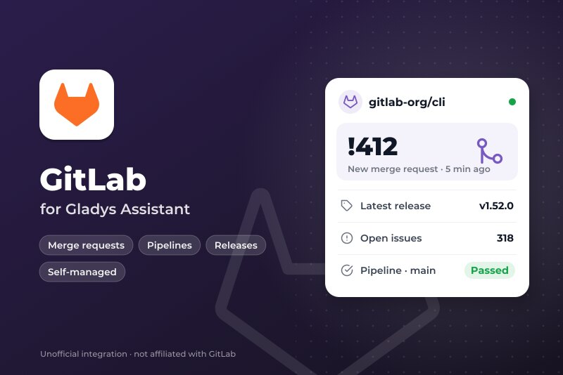
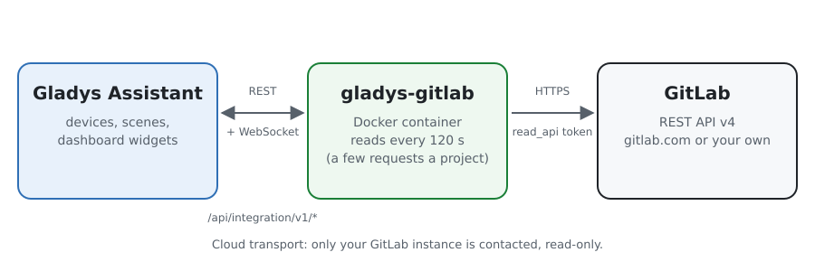
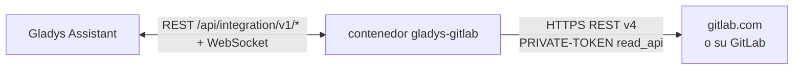
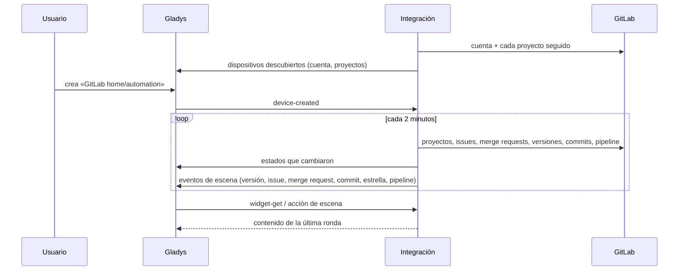
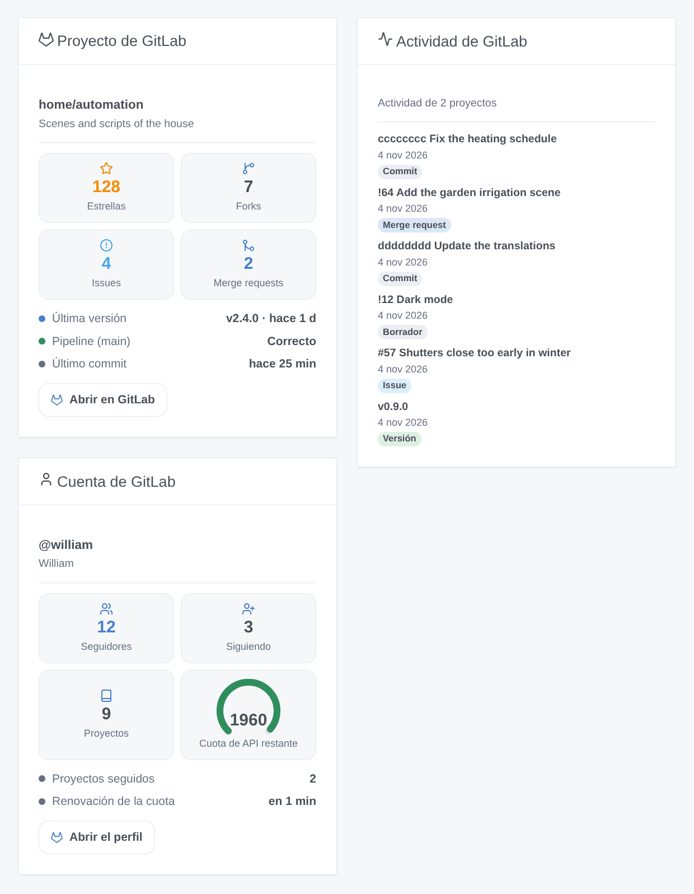
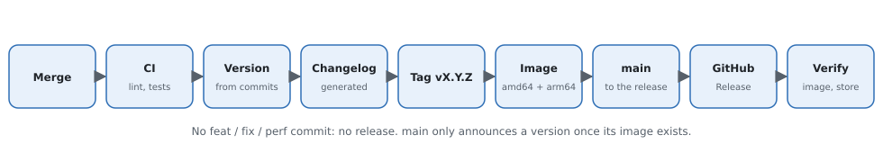

# Gladys GitLab

[English](README.md) · [Français](README.fr.md) · [Deutsch](README.de.md) · **Español**

[](LICENSE)
[](https://github.com/William-De71/gladys-gitlab/releases)
[](https://github.com/William-De71/gladys-gitlab/actions/workflows/release.yml)
[](https://gladysassistant.com)



Integración externa de [Gladys Assistant](https://gladysassistant.com) para **[GitLab](https://about.gitlab.com)**, en gitlab.com o en su propio GitLab autoalojado: siga proyectos en Gladys, sus versiones, issues, merge requests, pipelines y estrellas, en las escenas y en el panel. Lee la API REST v4 oficial de GitLab con un token de acceso de solo lectura.

## Funciones

- **Un dispositivo por proyecto seguido** (hasta 30) y **uno para su cuenta**: estrellas, forks, issues abiertas, merge requests abiertas y fusionadas, última versión, tag, commit, issue, merge request, y el estado del último pipeline de la rama por defecto.
- **6 desencadenantes de escena**, **1 acción de escena** y **3 widgets** (más abajo).
- gitlab.com o un **GitLab autoalojado**, en la dirección que elija.
- Los patrones `grupo/*` y `grupo/prefijo*` siguen todos los proyectos de un grupo (subgrupos incluidos) o de un usuario.
- Solo lectura: nunca se escribe nada en GitLab. Un botón de configuración prueba el token.
- Cuatro idiomas en todas partes: inglés, francés, alemán, español.

## Funcionamiento





Cada 2 minutos por defecto (60 a 3600 segundos), la integración lee la cuenta del token y luego cada proyecto seguido con unas pocas peticiones pequeñas: el proyecto, sus últimas issues y merge requests, el número de merge requests abiertas y fusionadas (cabecera `x-total`), sus versiones, su último tag, los commits y el último pipeline de la rama por defecto. Cada ronda se compara con la anterior para activar los desencadenantes de escena; la primera ronda sirve de referencia y no activa nada. Una parte que un proyecto no tiene (merge requests desactivadas, repositorio vacío) simplemente se omite.



### Transporte

Solo nube (`"transports": ["cloud"]`): el catálogo muestra la insignia de nube. La integración contacta la instancia de GitLab elegida (gitlab.com por defecto) por HTTPS con su token. Un GitLab autoalojado en su red se contacta igual, en su dirección; no hay botón «Preferir la conexión local».

## Dispositivos y funciones

| Función                             | Categoría / tipo         | Nota                                   |
| ----------------------------------- | ------------------------ | -------------------------------------- |
| Estrellas, forks, issues abiertas   | `counter-sensor/integer` | proyecto                               |
| Merge requests abiertas, fusionadas | `counter-sensor/integer` | proyecto                               |
| Última versión, tag, commit         | `text/text`              | proyecto                               |
| Última issue, última merge request  | `text/text`              | `#57 Título`, `!64 Título`             |
| Pipeline de la rama por defecto     | `text/text`              | Correcto, Fallido, Cancelado, En curso |
| Seguidores, seguidos, proyectos     | `counter-sensor/integer` | cuenta del token                       |

`should_poll: false`: la integración lee GitLab a su propio ritmo. Los identificadores externos se basan en los identificadores numéricos de GitLab: renombrar o mover un proyecto conserva su dispositivo. Un contador que GitLab no dio no se publica, nunca se pone a 0.

## Desencadenantes, acción de escena y widgets



**Desencadenantes** (filtro: el dispositivo del proyecto)

- **Versión publicada**: un proyecto seguido publica una versión (una versión futura cuenta en su fecha).
- **Issue abierta** y **Merge request abierta** (con su indicador `draft`).
- **Nuevo commit**: un commit llega a la rama por defecto.
- **Nueva estrella**: el número de estrellas sube.
- **Pipeline terminado**: el último pipeline de la rama por defecto termina bien, falla o se cancela (filtro: resultado).

Cada evento lleva el proyecto, su ruta, el elemento (número, título, autor, enlace) y una frase `summary` lista para un mensaje.

**Acción**: leer un proyecto (estrellas, forks, issues y merge requests abiertas, última versión y último commit, pipeline, `summary`).

**Widgets**: **Proyecto GitLab** (casillas, última versión, pipeline, último commit, enlace), **Actividad GitLab** (últimas versiones, issues, merge requests y commits, de la más reciente a la más antigua) y **Cuenta GitLab** (seguidores, seguidos, proyectos, cuota de API en gitlab.com).

**Ejemplos**

- Cuando **el pipeline de `main` falla** → una notificación con el mensaje del commit.
- Cuando **se publica una versión** → un mensaje al grupo familiar «el panel tiene una nueva versión».
- Cuando **alguien abre una merge request** en su proyecto → un sonido en el despacho.

## Requisitos

- Gladys Assistant **5.3.0** o posterior (palabras clave del catálogo). Las instancias más antiguas no pueden instalar la integración.
- Una cuenta en gitlab.com o en un GitLab autoalojado, y un token de acceso con el alcance **`read_api`**.

## Instalación

- **Desde la tienda** de Gladys (Integraciones → Integraciones externas), con un clic, una vez indexada.
- **Desde la URL del repositorio**: `https://github.com/William-De71/gladys-gitlab`.
- **Modo desarrollador**: construya la imagen en local (`docker build -t gladys-gitlab .`) e instálela desde Gladys.

## Configuración

| Campo                               | Por defecto        | Función                                                                        |
| ----------------------------------- | ------------------ | ------------------------------------------------------------------------------ |
| Dirección de la instancia de GitLab | https://gitlab.com | O la dirección de su GitLab autoalojado.                                       |
| Token de acceso                     | —                  | Un token personal, de grupo o de proyecto con el alcance `read_api` (secreto). |
| Proyectos a seguir                  | —                  | `grupo/proyecto`, enlaces, `grupo/*`, `grupo/prefijo*`; 30 como máximo.        |
| Intervalo de lectura (s)            | 120                | 60 a 3600 segundos; también el retraso de los desencadenantes.                 |
| Idioma de los textos                | automático         | Nombres de los dispositivos, resúmenes y salidas de las escenas.               |

## Uso

1. En GitLab, abra **Preferencias → Tokens de acceso** y añada un token solo con el alcance `read_api`.
2. Introduzca la dirección (si no es gitlab.com), el token y los proyectos y guarde; pulse **Probar la conexión**.
3. En la pestaña **Descubrir**, cree los dispositivos «GitLab …».
4. Añada los widgets **Proyecto GitLab**, **Actividad GitLab** y **Cuenta GitLab**, y construya escenas con los desencadenantes de arriba.

## Desarrollo

```bash
npm install
npm test                       # node --test, sin tocar nunca la red
npm run lint && npm run format:check
npx github:GladysAssistant/integration-store . --skip-image-check
scripts/build-cover.sh         # cover.jpg a partir de docs/assets/cover.svg
docs/illustrations/render.sh   # docs/assets/widgets.<idioma>.png
node .github/scripts/release.mjs next
```

En local, el SDK lee `GLADYS_HOST_API_URL`, `GLADYS_INTEGRATION_TOKEN` y `GLADYS_INTEGRATION_SELECTOR`; `DEBUG=gladys-integration-sdk` muestra los registros del SDK. Las pruebas sirven una falsa API REST de GitLab (`test/helpers/fixtures.js`) según la [documentación de la API](https://docs.gitlab.com/api/rest/). Las reglas del proyecto están en [CLAUDE.md](CLAUDE.md).

## Proceso de publicación



Cada fusión en `main` lanza la CI y luego calcula la versión a partir de los [Conventional Commits](https://www.conventionalcommits.org/) desde la última etiqueta: `feat` → menor, `fix` / `perf` → parche, `!` o `BREAKING CHANGE` → mayor (una menor por debajo de 1.0.0); `docs`, `chore`, `ci`, `test`, `style`, `refactor`, `build` solos no publican nada. Se genera la sección del changelog, se envía la etiqueta, se construye la imagen multiarquitectura, luego `main` recibe el commit de versión, se crea la GitHub Release y un último job comprueba la imagen pública, el validador de la tienda y el topic.

- El título de la pull request se convierte en el commit squash y luego en la línea del changelog: escríbalo en inglés, para el usuario (`pr-title.yml` lo comprueba). No edite nunca `CHANGELOG.md` a mano.
- La 1.0.0 es una decisión: Actions → Release → Run workflow con `release-as: 1.0.0`. `dry-run` muestra la versión y las notas sin publicar.
- **Rama protegida**: la publicación envía su commit a `main` con `GITHUB_TOKEN`. Con un ruleset que exija pull requests o comprobaciones en `main`, añada GitHub Actions a su lista de omisión (o envíe mediante una GitHub App); si no, el job de publicación falla con instrucciones.
- Tras la primera publicación, haga público el paquete `ghcr.io` (Package settings → Change visibility); si no, Gladys no puede descargarlo.

## Solución de problemas

Vea [docs/es.md](docs/es.md#solución-de-problemas). Informe de los problemas con las versiones de Gladys y de la integración, y los registros de la integración (nunca su token).

## Contribuir

Issues y pull requests bienvenidas. Ejecute `npm run format:check && npm run lint && npm test` antes de abrir una pull request, y mantenga sin cambios todos los identificadores externos y claves guardadas (vea [CLAUDE.md](CLAUDE.md)).

## Seguridad

Vea [SECURITY.md](SECURITY.md): informe de las vulnerabilidades en privado. El token es un campo `secret` de Gladys, enviado solo a la instancia de GitLab elegida, en la cabecera `PRIVATE-TOKEN` por HTTPS, y nunca escrito en los registros. Un token `read_api` no puede cambiar nada en GitLab. La integración funciona en solo lectura, sin privilegios de root, en su contenedor.

## Capturas por venir

Las imágenes de arriba son ilustraciones, no capturas de pantalla. Las capturas reales irán en `docs/assets/screenshots/` (PNG, 1280 × 800): `configuration.png`, `discovery.png`, `device.png`, `scene.png`.

## Licencia

[Apache License 2.0](LICENSE) — vea también [NOTICE](NOTICE). GitLab es una marca de GitLab Inc.; esta integración no está afiliada a GitLab. Gracias a la documentación y al SDK de Gladys, y a GitLab por la documentación pública de su API.
