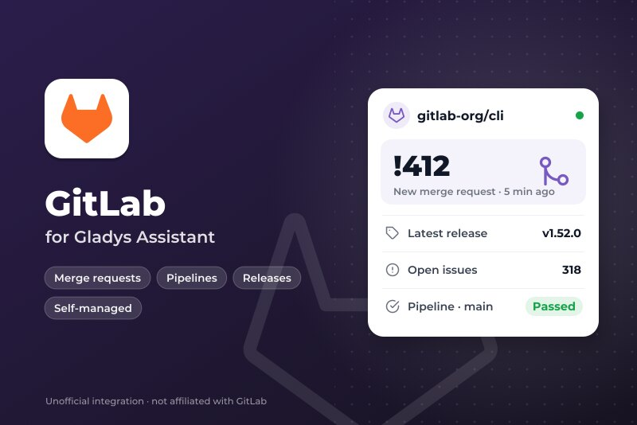
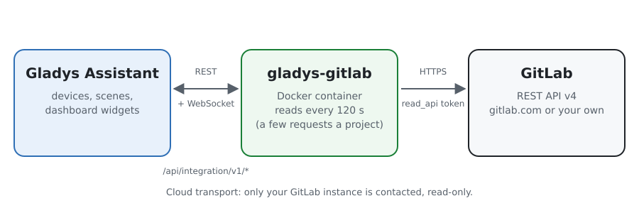
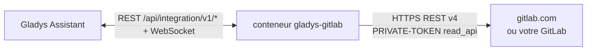
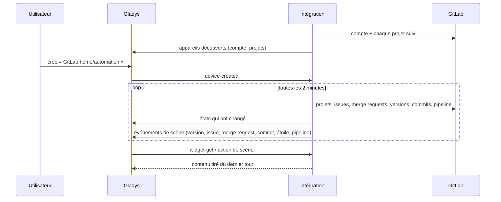
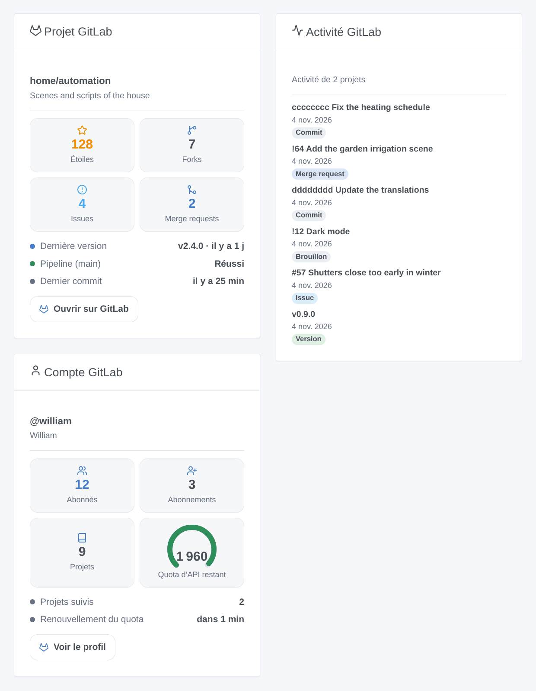
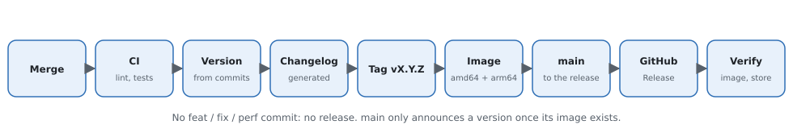

# Gladys GitLab

[English](README.md) · **Français** · [Deutsch](README.de.md) · [Español](README.es.md)

[](LICENSE)
[](https://github.com/William-De71/gladys-gitlab/releases)
[](https://github.com/William-De71/gladys-gitlab/actions/workflows/release.yml)
[](https://gladysassistant.com)



Intégration externe [Gladys Assistant](https://gladysassistant.com) pour **[GitLab](https://about.gitlab.com)**, sur gitlab.com ou sur votre propre GitLab auto-hébergé : suivez des projets dans Gladys, leurs versions, issues, merge requests, pipelines et étoiles, dans les scènes et sur le tableau de bord. Elle lit l’API REST v4 officielle de GitLab avec un jeton d’accès en lecture seule.

## Fonctionnalités

- **Un appareil par projet suivi** (jusqu’à 30) et **un pour votre compte** : étoiles, forks, issues ouvertes, merge requests ouvertes et fusionnées, dernière version, tag, commit, issue, merge request, et l’état du dernier pipeline de la branche par défaut.
- **6 déclencheurs de scène**, **1 action de scène** et **3 widgets** (plus bas).
- gitlab.com ou un **GitLab auto-hébergé**, à l’adresse de votre choix.
- Les motifs `groupe/*` et `groupe/préfixe*` suivent tous les projets d’un groupe (sous-groupes compris) ou d’un utilisateur.
- Lecture seule : rien n’est jamais écrit dans GitLab. Un bouton de configuration teste le jeton.
- Quatre langues partout : anglais, français, allemand, espagnol.

## Fonctionnement





Toutes les 2 minutes par défaut (60 à 3 600 secondes), l’intégration lit le compte du jeton, puis chaque projet suivi en quelques petites requêtes : le projet, ses dernières issues et merge requests, le nombre de merge requests ouvertes et fusionnées (en-tête `x-total`), ses versions, son dernier tag, les commits et le dernier pipeline de la branche par défaut. Chaque tour est comparé au précédent pour déclencher les scènes ; le premier tour sert de référence et ne déclenche rien. Une partie qu’un projet n’a pas (merge requests désactivées, dépôt vide) est simplement laissée de côté.



### Transport

Cloud uniquement (`"transports": ["cloud"]`) : le catalogue affiche le badge cloud. L’intégration contacte l’instance GitLab choisie (gitlab.com par défaut) en HTTPS avec votre jeton. Un GitLab auto-hébergé sur votre réseau est joint de la même façon, à son adresse ; il n’y a pas de bouton « Préférer la connexion locale ».

## Appareils et fonctionnalités

| Fonctionnalité                         | Catégorie / type         | Remarque                         |
| -------------------------------------- | ------------------------ | -------------------------------- |
| Étoiles, forks, issues ouvertes        | `counter-sensor/integer` | projet                           |
| Merge requests ouvertes, fusionnées    | `counter-sensor/integer` | projet                           |
| Dernière version, tag, commit          | `text/text`              | projet                           |
| Dernière issue, dernière merge request | `text/text`              | `#57 Titre`, `!64 Titre`         |
| Pipeline de la branche par défaut      | `text/text`              | Réussi, Échoué, Annulé, En cours |
| Abonnés, abonnements, projets          | `counter-sensor/integer` | compte du jeton                  |

`should_poll: false` : l’intégration lit GitLab à son propre rythme. Les identifiants externes reposent sur les identifiants numériques de GitLab : renommer ou déplacer un projet garde son appareil. Un compteur que GitLab n’a pas donné n’est pas publié, jamais mis à 0.

## Déclencheurs, action de scène et widgets



**Déclencheurs** (filtre : l’appareil du projet)

- **Version publiée** : un projet suivi publie une version (une version à venir compte à sa date).
- **Issue ouverte** et **Merge request ouverte** (avec son indicateur `draft`).
- **Nouveau commit** : un commit arrive sur la branche par défaut.
- **Nouvelle étoile** : le nombre d’étoiles augmente.
- **Pipeline terminé** : le dernier pipeline de la branche par défaut réussit, échoue ou est annulé (filtre : résultat).

Chaque événement porte le projet, son chemin, l’élément (numéro, titre, auteur, lien) et une phrase `summary` prête pour un message.

**Action** : lire un projet (étoiles, forks, issues et merge requests ouvertes, dernière version et dernier commit, pipeline, `summary`).

**Widgets** : **Projet GitLab** (tuiles, dernière version, pipeline, dernier commit, lien), **Activité GitLab** (dernières versions, issues, merge requests et commits, du plus récent au plus ancien) et **Compte GitLab** (abonnés, abonnements, projets, quota d’API sur gitlab.com).

**Exemples**

- Quand **le pipeline de `main` échoue** → une notification avec le message du commit.
- Quand **une version est publiée** → un message au groupe familial « le tableau de bord a une nouvelle version ».
- Quand **quelqu’un ouvre une merge request** sur votre projet → un son dans le bureau.

## Prérequis

- Gladys Assistant **5.3.0** ou plus récent (mots-clés du catalogue). Les instances plus anciennes ne peuvent pas installer l’intégration.
- Un compte sur gitlab.com ou sur un GitLab auto-hébergé, et un jeton d’accès avec la portée **`read_api`**.

## Installation

- **Depuis le store** de Gladys (Intégrations → Intégrations externes), en un clic, une fois indexée.
- **Depuis l’URL du dépôt** : `https://github.com/William-De71/gladys-gitlab`.
- **Mode développeur** : construisez l’image en local (`docker build -t gladys-gitlab .`) et installez-la depuis Gladys.

## Configuration

| Champ                        | Défaut             | Rôle                                                                           |
| ---------------------------- | ------------------ | ------------------------------------------------------------------------------ |
| Adresse de l’instance GitLab | https://gitlab.com | Ou l’adresse de votre GitLab auto-hébergé.                                     |
| Jeton d’accès                | —                  | Un jeton personnel, de groupe ou de projet avec la portée `read_api` (secret). |
| Projets à suivre             | —                  | `groupe/projet`, liens, `groupe/*`, `groupe/préfixe*` ; 30 au plus.            |
| Intervalle de lecture (s)    | 120                | 60 à 3 600 secondes ; c’est aussi le délai des déclencheurs.                   |
| Langue des textes            | automatique        | Noms des appareils, résumés et sorties des scènes.                             |

## Utilisation

1. Dans GitLab, ouvrez **Préférences → Jetons d’accès** et ajoutez un jeton avec la seule portée `read_api`.
2. Saisissez l’adresse (si ce n’est pas gitlab.com), le jeton et les projets, puis enregistrez ; appuyez sur **Tester la connexion**.
3. Dans l’onglet **Découverte**, créez les appareils « GitLab … ».
4. Ajoutez les widgets **Projet GitLab**, **Activité GitLab** et **Compte GitLab**, et construisez des scènes avec les déclencheurs ci-dessus.

## Développement

```bash
npm install
npm test                       # node --test, sans jamais toucher au réseau
npm run lint && npm run format:check
npx github:GladysAssistant/integration-store . --skip-image-check
scripts/build-cover.sh         # cover.jpg depuis docs/assets/cover.svg
docs/illustrations/render.sh   # docs/assets/widgets.<langue>.png
node .github/scripts/release.mjs next
```

En local, le SDK lit `GLADYS_HOST_API_URL`, `GLADYS_INTEGRATION_TOKEN` et `GLADYS_INTEGRATION_SELECTOR` ; `DEBUG=gladys-integration-sdk` affiche les journaux du SDK. Les tests servent une fausse API REST GitLab (`test/helpers/fixtures.js`) d’après la [documentation de l’API](https://docs.gitlab.com/api/rest/). Les règles du projet sont dans [CLAUDE.md](CLAUDE.md).

## Processus de publication



Chaque fusion sur `main` lance la CI, puis calcule la version à partir des [Conventional Commits](https://www.conventionalcommits.org/) depuis le dernier tag : `feat` → mineure, `fix` / `perf` → corrective, `!` ou `BREAKING CHANGE` → majeure (une mineure tant qu’on est sous 1.0.0) ; `docs`, `chore`, `ci`, `test`, `style`, `refactor`, `build` seuls ne publient rien. La section du changelog est générée, le tag poussé, l’image multi-architecture construite, puis `main` reçoit le commit de version, la GitHub Release est créée et un dernier job vérifie l’image publique, le validateur du store et le topic.

- Le titre de la pull request devient le commit squash, puis la ligne du changelog : écrivez-le en anglais, pour l’utilisateur (`pr-title.yml` le vérifie). Ne modifiez jamais `CHANGELOG.md` à la main.
- La 1.0.0 est une décision : Actions → Release → Run workflow avec `release-as: 1.0.0`. `dry-run` affiche la version et les notes sans rien publier.
- **Branche protégée** : la publication pousse son commit sur `main` avec `GITHUB_TOKEN`. Avec un ruleset qui impose des pull requests ou des vérifications sur `main`, ajoutez GitHub Actions à sa liste de contournement (ou poussez par une GitHub App), sinon le job de publication échoue avec des instructions.
- Après la première publication, rendez le paquet `ghcr.io` public (Package settings → Change visibility), sinon Gladys ne peut pas le télécharger.

## Dépannage

Voir [docs/fr.md](docs/fr.md#dépannage). Signalez un problème avec les versions de Gladys et de l’intégration, et les journaux de l’intégration (jamais votre jeton).

## Contribuer

Issues et pull requests bienvenues. Lancez `npm run format:check && npm run lint && npm test` avant d’ouvrir une pull request, et gardez inchangés tous les identifiants externes et clés stockées (voir [CLAUDE.md](CLAUDE.md)).

## Sécurité

Voir [SECURITY.md](SECURITY.md) : signalez les failles en privé. Le jeton est un champ `secret` de Gladys, envoyé uniquement à l’instance GitLab choisie, dans l’en-tête `PRIVATE-TOKEN` en HTTPS, et jamais écrit dans les journaux. Un jeton `read_api` ne peut rien modifier dans GitLab. L’intégration tourne en lecture seule, sans droits root, dans son conteneur.

## Captures à venir

Les images ci-dessus sont des illustrations, pas des captures d’écran. Les vraies captures iront dans `docs/assets/screenshots/` (PNG, 1280 × 800) : `configuration.png`, `discovery.png`, `device.png`, `scene.png`.

## Licence

[Apache License 2.0](LICENSE) — voir aussi [NOTICE](NOTICE). GitLab est une marque de GitLab Inc. ; cette intégration n’est pas affiliée à GitLab. Merci à la documentation et au SDK de Gladys, et à GitLab pour la documentation publique de son API.
