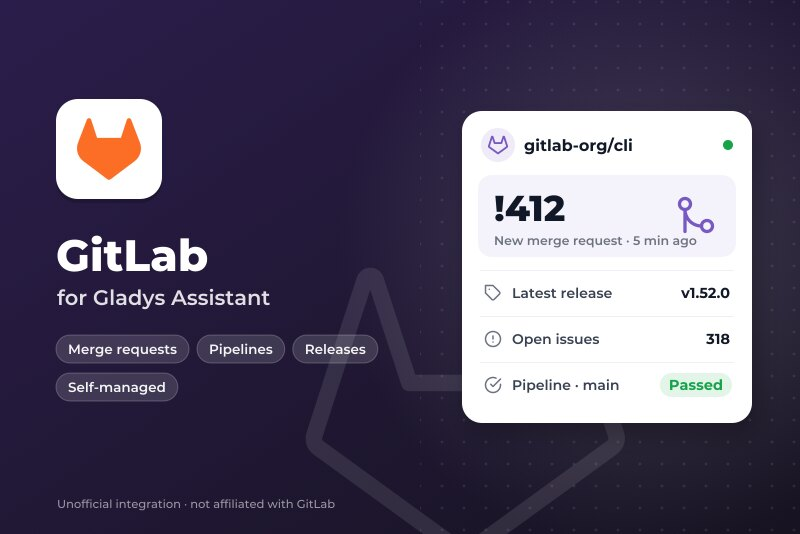
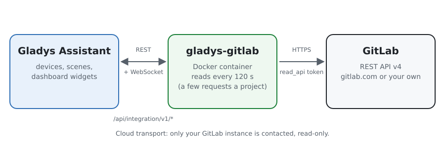
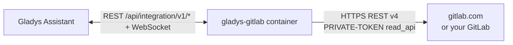
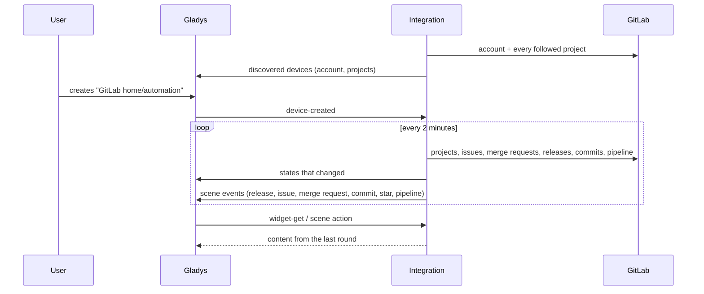
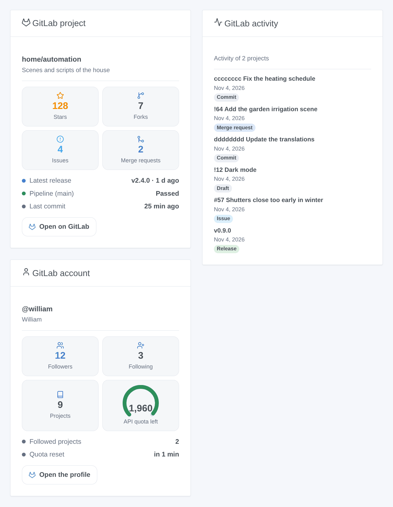
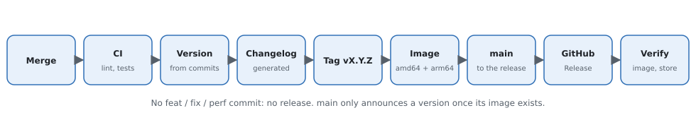

# Gladys GitLab

**English** · [Français](README.fr.md) · [Deutsch](README.de.md) · [Español](README.es.md)

[](LICENSE)
[](https://github.com/William-De71/gladys-gitlab/releases)
[](https://github.com/William-De71/gladys-gitlab/actions/workflows/release.yml)
[](https://gladysassistant.com)



[Gladys Assistant](https://gladysassistant.com) external integration for **[GitLab](https://about.gitlab.com)**, on gitlab.com or on your own self-managed GitLab: follow projects in Gladys, their releases, issues, merge requests, pipelines and stars, in scenes and on the dashboard. It reads the official GitLab REST API v4 with a read-only access token.

## Features

- **One device per followed project** (up to 30) and **one for your account**: stars, forks, open issues, open and merged merge requests, the latest release, tag, commit, issue, merge request, and the state of the last pipeline of the default branch.
- **6 scene triggers**, **1 scene action** and **3 dashboard widgets** (below).
- gitlab.com or a **self-managed GitLab**, at the address of your choice.
- `group/*` and `group/prefix*` patterns follow every project of a group (subgroups included) or of a user.
- Read only: nothing is ever written to GitLab. A configuration button tests the token.
- Four languages everywhere: English, French, German, Spanish.

## How it works





Every 2 minutes by default (60 to 3,600 seconds), the integration reads the account of the token, then each followed project with a few small requests: the project, its newest issues and merge requests, the counts of the open and merged merge requests (`x-total` header), its releases, newest tag, the commits and the last pipeline of the default branch. Each round is compared with the previous one to fire the scene triggers; the first round is a baseline and fires nothing. A part a project does not have (merge requests turned off, an empty repository) is simply left out.



### Transport

Cloud only (`"transports": ["cloud"]`): the catalog shows the cloud badge. The integration contacts the GitLab instance you set (gitlab.com by default) over HTTPS with your token. A self-managed GitLab on your network is reached the same way, at its address; there is no "prefer the local connection" button.

## Devices and features

| Feature                                    | Category / type          | Note                              |
| ------------------------------------------ | ------------------------ | --------------------------------- |
| Stars, forks, open issues                  | `counter-sensor/integer` | project                           |
| Open merge requests, merged merge requests | `counter-sensor/integer` | project                           |
| Latest release, tag, commit                | `text/text`              | project                           |
| Latest issue, latest merge request         | `text/text`              | `#57 Title`, `!64 Title`          |
| Pipeline of the default branch             | `text/text`              | Passed, Failed, Canceled, Running |
| Followers, following, projects             | `counter-sensor/integer` | account of the token              |

`should_poll: false`: the integration reads GitLab on its own timer. External ids are built on the numeric ids of GitLab: renaming or moving a project keeps its device. A counter GitLab did not give is not published, never set to 0.

## Scene triggers, action and widgets



**Triggers** (filter: the project device)

- **Release published**: a followed project publishes a release (an upcoming release counts on its date).
- **Issue opened** and **Merge request opened** (with its `draft` flag).
- **New commit**: a commit lands on the default branch.
- **New star**: the star count goes up.
- **Pipeline completed**: the last pipeline of the default branch succeeds, fails or is canceled (filter: result).

Every event carries the project, its path, the item (number, title, author, link) and a `summary` sentence ready for a message.

**Action**: read a project (stars, forks, open issues and merge requests, latest release and commit, pipeline, `summary`).

**Widgets**: **GitLab project** (tiles, latest release, pipeline, last commit, link), **GitLab activity** (latest releases, issues, merge requests and commits, newest first) and **GitLab account** (followers, following, projects, API quota on gitlab.com).

**Examples**

- When **the pipeline of `main` fails** → a notification with the commit message.
- When **a release is published** → a message to the family chat "the dashboard got a new version".
- When **someone opens a merge request** on your project → a sound in the office.

## Requirements

- Gladys Assistant **5.3.0** or later (catalog keywords). Older instances cannot install the integration.
- An account on gitlab.com or on a self-managed GitLab, and an access token with the **`read_api`** scope.

## Installation

- **From the store** of Gladys (Integrations → External integrations), in one click, once indexed.
- **From the repository URL**: `https://github.com/William-De71/gladys-gitlab`.
- **Developer mode**: build the image locally (`docker build -t gladys-gitlab .`) and install it from Gladys.

## Configuration

| Field                          | Default            | Role                                                                   |
| ------------------------------ | ------------------ | ---------------------------------------------------------------------- |
| Address of the GitLab instance | https://gitlab.com | Or the address of your self-managed GitLab.                            |
| Access token                   | —                  | A personal, group or project token with the `read_api` scope (secret). |
| Projects to follow             | —                  | `group/project`, links, `group/*`, `group/prefix*`; 30 at most.        |
| Reading interval (s)           | 120                | 60 to 3,600 seconds; also the delay of the scene triggers.             |
| Language of the texts          | automatic          | Device names, scene summaries and outputs.                             |

## Usage

1. In GitLab, open **Preferences → Access tokens** and add a token with the `read_api` scope only.
2. Enter the address (if not gitlab.com), the token and the projects, then save; press **Test the connection**.
3. In the **Discover** tab, create the "GitLab …" devices.
4. Add the **GitLab project**, **GitLab activity** and **GitLab account** widgets, and build scenes with the triggers above.

## Development

```bash
npm install
npm test                       # node --test, never touches the network
npm run lint && npm run format:check
npx github:GladysAssistant/integration-store . --skip-image-check
scripts/build-cover.sh         # cover.jpg from docs/assets/cover.svg
docs/illustrations/render.sh   # docs/assets/widgets.<lang>.png
node .github/scripts/release.mjs next
```

Locally, the SDK reads `GLADYS_HOST_API_URL`, `GLADYS_INTEGRATION_TOKEN` and `GLADYS_INTEGRATION_SELECTOR`; `DEBUG=gladys-integration-sdk` shows the SDK logs. The tests serve a fake GitLab REST API (`test/helpers/fixtures.js`) after the [API documentation](https://docs.gitlab.com/api/rest/). The rules of the project are in [CLAUDE.md](CLAUDE.md).

## Release process



Every merge on `main` runs the CI, then computes the version from the [Conventional Commits](https://www.conventionalcommits.org/) since the last tag: `feat` → minor, `fix` / `perf` → patch, `!` or `BREAKING CHANGE` → major (a minor below 1.0.0); `docs`, `chore`, `ci`, `test`, `style`, `refactor`, `build` alone publish nothing. The changelog section is generated, the tag pushed, the multi-architecture image built, then `main` receives the release commit, the GitHub Release is created and a last job checks the public image, the store validator and the topic.

- The pull request title becomes the squash commit, then the changelog line: write it in English, for the user (`pr-title.yml` checks it). Never edit `CHANGELOG.md` by hand.
- 1.0.0 is a decision: Actions → Release → Run workflow with `release-as: 1.0.0`. `dry-run` shows the version and the notes without publishing.
- **Protected branch**: the release pushes its commit to `main` with `GITHUB_TOKEN`. With a ruleset requiring pull requests or status checks on `main`, add GitHub Actions to its bypass list (or push through a GitHub App), otherwise the publish job fails with instructions.
- After the first release, make the `ghcr.io` package public (Package settings → Change visibility), or Gladys cannot pull it.

## Troubleshooting

See [docs/en.md](docs/en.md#troubleshooting). Report issues with the versions of Gladys and of the integration, and the logs of the integration (never your token).

## Contributing

Issues and pull requests are welcome. Run `npm run format:check && npm run lint && npm test` before opening a pull request, and keep every external id and stored key unchanged (see [CLAUDE.md](CLAUDE.md)).

## Security

See [SECURITY.md](SECURITY.md): report vulnerabilities privately. The token is a `secret` field of Gladys, sent only to the GitLab instance you set, in the `PRIVATE-TOKEN` header over HTTPS, and never written to the logs. A `read_api` token cannot change anything in GitLab. The integration runs read-only, as a non-root user, in its container.

## Screenshots to come

The images above are illustrations, not screenshots. Real screenshots will go in `docs/assets/screenshots/` (PNG, 1280 × 800): `configuration.png`, `discovery.png`, `device.png`, `scene.png`.

## License

[Apache License 2.0](LICENSE) — see also [NOTICE](NOTICE). GitLab is a trademark of GitLab Inc.; this integration is not affiliated with GitLab. Thanks to the Gladys documentation and SDK, and to GitLab for its public API documentation.
