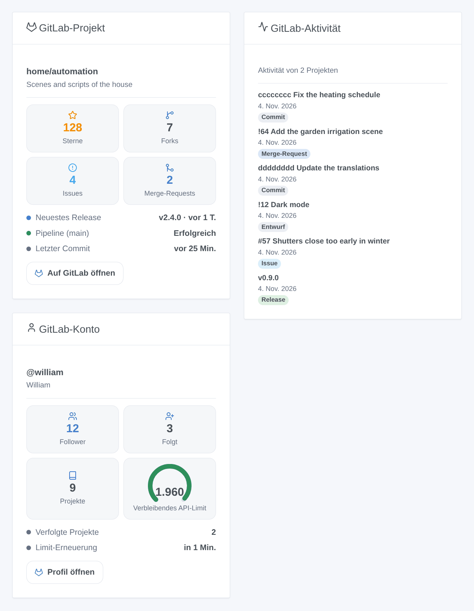

# GitLab

## Überblick

Diese Integration verfolgt **GitLab**-Projekte in Gladys, auf gitlab.com oder auf deinem eigenen, selbst gehosteten GitLab: Ihre Releases, Issues, Merge-Requests, Pipelines und Sterne werden zu Geräten, Szenenauslösern und Dashboard-Widgets. Sie liest die offizielle REST-API v4 von GitLab mit einem Zugriffstoken, nur lesend, und schreibt nie in GitLab.

Jedes verfolgte Projekt wird zu einem Gerät, neben einem Gerät für dein Konto. Szenenauslöser reagieren auf ein neues Release, Issue, einen neuen Merge-Request, Commit oder Stern und auf das Ende der Pipeline des Standard-Branches.

GitLab ist eine Marke von GitLab Inc. Diese Integration ist nicht mit GitLab verbunden.

## Voraussetzungen

- Gladys Assistant 5.3.0 oder neuer.
- Ein Konto auf gitlab.com oder auf einem selbst gehosteten GitLab.
- Ein Zugriffstoken mit dem Bereich `read_api`: Öffne in GitLab **Einstellungen → Zugriffstoken**, füge ein Token hinzu, hake nur **read_api** an und kopiere es. Ein Gruppen- oder Projekt-Zugriffstoken mit `read_api` geht auch.

## Konfiguration

| Feld                       | Rolle                                                                                              |
| -------------------------- | -------------------------------------------------------------------------------------------------- |
| Adresse der GitLab-Instanz | Standardmäßig https://gitlab.com, oder die Adresse deines selbst gehosteten GitLab.                |
| Zugriffstoken              | Das Token mit dem Bereich `read_api`.                                                              |
| Zu verfolgende Projekte    | `Gruppe/Projekt` (mit Untergruppen) oder sein Link; `Gruppe/*` und `Gruppe/Präfix*`; höchstens 30. |
| Leseintervall (s)          | 60 bis 3.600 Sekunden, standardmäßig 120; auch die Verzögerung der Szenenauslöser.                 |
| Sprache der Texte          | Namen der Geräte, Zusammenfassungen und Ausgaben der Szenen; standardmäßig automatisch.            |

Speichern, dann **Verbindung testen** drücken: Das Ergebnis nennt das Konto des Tokens und sagt, wie viele Projekte gelesen wurden.

## Verwendung

### Geräte

Erstelle in **Entdecken** das Gerät „GitLab @Benutzername“ (Follower, gefolgt, Projekte) und ein Gerät „GitLab Gruppe/Projekt“ pro Projekt: Sterne, Forks, offene Issues, offene und gemergte Merge-Requests, neuestes Release, Tag, Commit, Issue und Merge-Request sowie die Pipeline des Standard-Branches (Erfolgreich, Fehlgeschlagen, Abgebrochen, Läuft).

### Szenenauslöser

Alle filtern nach Projekt (leer lassen für jedes):

- **Release veröffentlicht**: Ein kommendes Release zählt an seinem Datum.
- **Issue geöffnet**, **Merge-Request geöffnet** (Variable `draft`).
- **Neuer Commit** auf dem Standard-Branch.
- **Neuer Stern**.
- **Pipeline abgeschlossen**: erfolgreich, fehlgeschlagen oder abgebrochen (Filter: Ergebnis).

Jedes Ereignis liefert das Projekt, das Element (Nummer, Titel, Autor, Link) und einen Satz `summary`. Die erste Abfrage nach einem Start oder einem neuen Token ist die Referenz: Nichts wird ausgelöst.

### Szenenaktion

**Ein Projekt lesen** liefert seine Zähler, neuestes Release und neuesten Commit, Pipeline und einen Satz `summary`. Ein unbekannter Zähler ist -1.

### Widgets

- **GitLab-Projekt**: Sterne, Forks, Issues, Merge-Requests, neuestes Release, Pipeline, letzter Commit, ein Link.
- **GitLab-Aktivität**: die neuesten Releases, Issues, Merge-Requests und Commits aller Projekte (oder eines), neueste zuerst.
- **GitLab-Konto**: Follower, gefolgt, Projekte und das verbleibende API-Kontingent auf gitlab.com.

## Fehlerbehebung

- **„GitLab hat das Token abgelehnt“**: Das Token ist falsch, abgelaufen oder widerrufen: Erstelle ein neues.
- **„GitLab hat den Zugriff mit diesem Token verweigert“**: Dem Token fehlt der Bereich `read_api`.
- **„Nicht gefunden oder für das Token nicht sichtbar“**: Prüfe den Pfad (`Gruppe/Untergruppe/Projekt`) und ob das Token das Projekt sieht (private Projekte brauchen das Token eines Mitglieds).
- **„GitLab ist unter dieser Adresse nicht erreichbar“**: Prüfe die Adresse deiner Instanz und ob Gladys sie erreicht.
- **Keine Pipeline oder Merge-Requests**: Das Projekt hat sie deaktiviert oder noch keine Pipeline auf seinem Standard-Branch; diese Funktionen werden einfach ausgelassen.
- Melde Probleme mit den Versionen von Gladys und der Integration und ihren Logs; füge nie dein Token ein.
