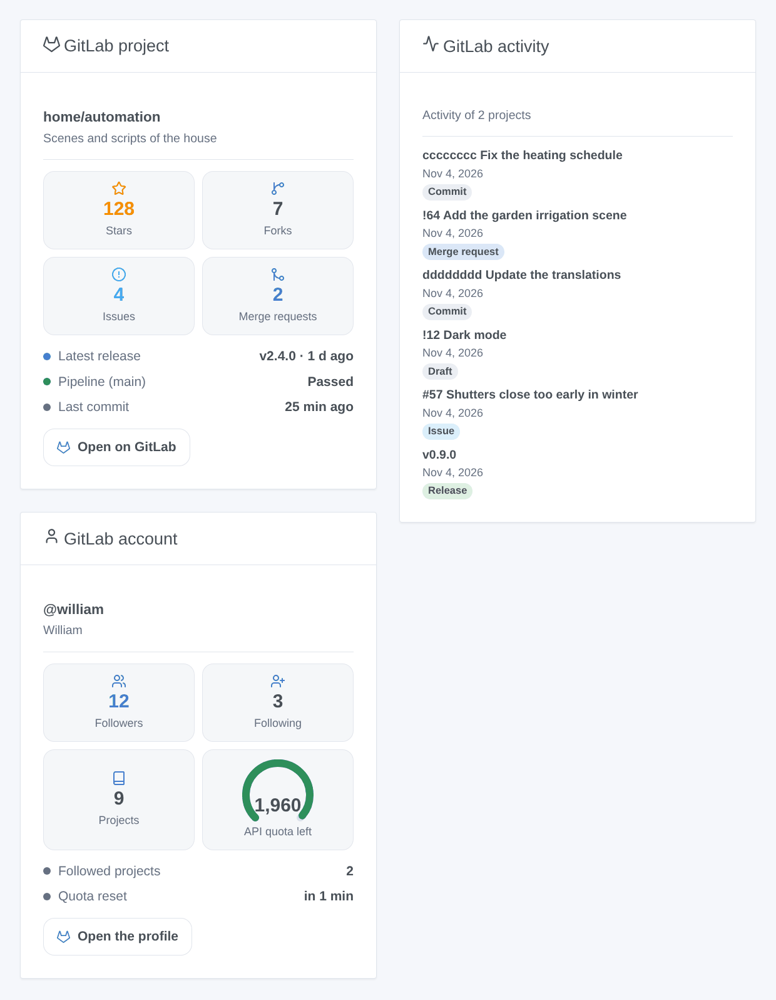

# GitLab

## Overview

This integration follows **GitLab** projects in Gladys, on gitlab.com or on your own self-managed GitLab: their releases, issues, merge requests, pipelines and stars become devices, scene triggers and dashboard widgets. It reads the official GitLab REST API v4 with a read-only access token, and never writes to GitLab.

Each followed project becomes a device, next to a device for your account. Scene triggers react to a new release, issue, merge request, commit or star, and to the end of the pipeline of the default branch.

GitLab is a trademark of GitLab Inc. This integration is not affiliated with GitLab.

## Requirements

- Gladys Assistant 5.3.0 or later.
- An account on gitlab.com or on a self-managed GitLab.
- An access token with the `read_api` scope: in GitLab, open **Preferences → Access tokens**, add a token, tick **read_api** only and copy it. A group or project access token with `read_api` works too.

## Configuration

| Field                          | Role                                                                                         |
| ------------------------------ | -------------------------------------------------------------------------------------------- |
| Address of the GitLab instance | https://gitlab.com by default, or the address of your self-managed GitLab.                   |
| Access token                   | The token with the `read_api` scope.                                                         |
| Projects to follow             | `group/project` (subgroups included) or its link; `group/*` and `group/prefix*`; 30 at most. |
| Reading interval (s)           | 60 to 3,600 seconds, 120 by default; also the delay of the scene triggers.                   |
| Language of the texts          | Device names, scene summaries and outputs; automatic by default.                             |

Save, then press **Test the connection**: it names the account of the token and says how many projects were read.

## Usage

### Devices

In **Discover**, create the "GitLab @username" device (followers, following, projects) and one "GitLab group/project" device per project: stars, forks, open issues, open and merged merge requests, the latest release, tag, commit, issue and merge request, and the pipeline of the default branch (Passed, Failed, Canceled, Running).

### Scene triggers

All of them filter by project (leave empty for any):

- **Release published**: an upcoming release counts on its date.
- **Issue opened**, **Merge request opened** (variable `draft`).
- **New commit** on the default branch.
- **New star**.
- **Pipeline completed**: success, failed or canceled (filter: result).

Every event gives the project, the item (number, title, author, link) and a `summary` sentence. The first reading after a start or a new token is a baseline: nothing fires.

### Scene action

**Read a project** gives its counters, latest release and commit, pipeline and a `summary` sentence. An unknown counter is -1.

### Widgets

- **GitLab project**: stars, forks, issues, merge requests, latest release, pipeline, last commit, a link.
- **GitLab activity**: the latest releases, issues, merge requests and commits of every project (or of one), newest first.
- **GitLab account**: followers, following, projects, and the API quota left on gitlab.com.

## Troubleshooting

- **"GitLab refused the token"**: the token is wrong, expired or revoked: create a new one.
- **"GitLab denied access with this token"**: the token lacks the `read_api` scope.
- **"Not found or not visible to the token"**: check the path (`group/subgroup/project`), and that the token can see the project (private projects need a token of a member).
- **"GitLab cannot be reached at this address"**: check the address of your instance, and that Gladys can reach it.
- **No pipeline or merge requests**: the project has them turned off, or has no pipeline on its default branch yet; these features are simply left out.
- Report a problem with the versions of Gladys and of the integration and its logs; never paste your token.
