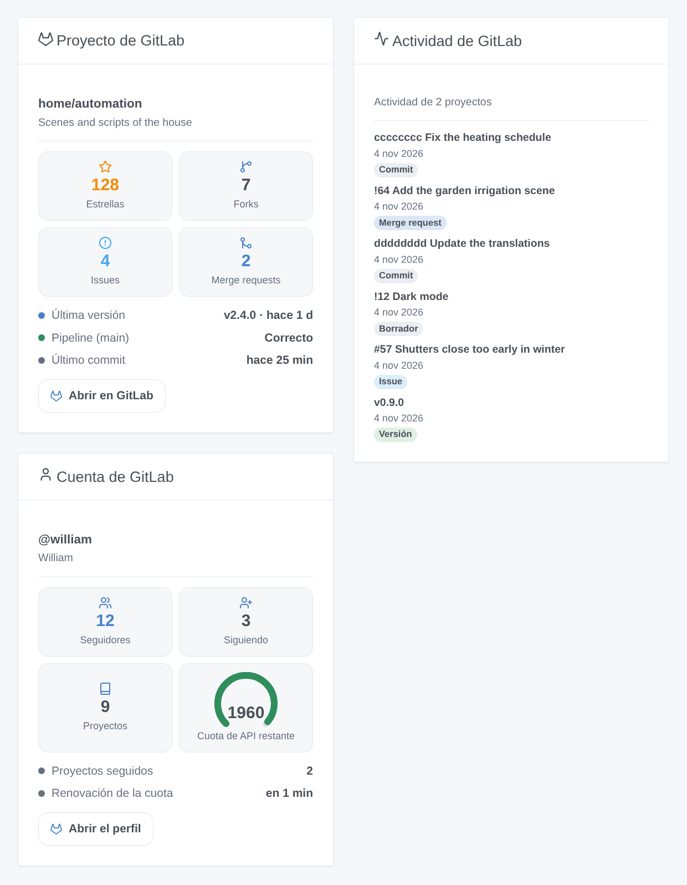

# GitLab

## Presentación

Esta integración sigue proyectos de **GitLab** en Gladys, en gitlab.com o en su propio GitLab autoalojado: sus versiones, issues, merge requests, pipelines y estrellas se convierten en dispositivos, desencadenantes de escena y widgets. Lee la API REST v4 oficial de GitLab con un token de acceso de solo lectura, y nunca escribe en GitLab.

Cada proyecto seguido se convierte en un dispositivo, junto a un dispositivo para su cuenta. Los desencadenantes de escena reaccionan a una nueva versión, issue, merge request, commit o estrella, y al final del pipeline de la rama por defecto.

GitLab es una marca de GitLab Inc. Esta integración no está afiliada a GitLab.

## Requisitos

- Gladys Assistant 5.3.0 o posterior.
- Una cuenta en gitlab.com o en un GitLab autoalojado.
- Un token de acceso con el alcance `read_api`: en GitLab, abra **Preferencias → Tokens de acceso**, añada un token, marque solo **read_api** y cópielo. También sirve un token de acceso de grupo o de proyecto con `read_api`.

## Configuración

| Campo                               | Función                                                                                           |
| ----------------------------------- | ------------------------------------------------------------------------------------------------- |
| Dirección de la instancia de GitLab | https://gitlab.com por defecto, o la dirección de su GitLab autoalojado.                          |
| Token de acceso                     | El token con el alcance `read_api`.                                                               |
| Proyectos a seguir                  | `grupo/proyecto` (subgrupos incluidos) o su enlace; `grupo/*` y `grupo/prefijo*`; 30 como máximo. |
| Intervalo de lectura (s)            | 60 a 3600 segundos, 120 por defecto; también el retraso de los desencadenantes.                   |
| Idioma de los textos                | Nombres de los dispositivos, resúmenes y salidas de las escenas; automático por defecto.          |

Guarde y pulse **Probar la conexión**: el resultado nombra la cuenta del token y dice cuántos proyectos se leyeron.

## Uso

### Dispositivos

En **Descubrir**, cree el dispositivo «GitLab @usuario» (seguidores, seguidos, proyectos) y un dispositivo «GitLab grupo/proyecto» por proyecto: estrellas, forks, issues abiertas, merge requests abiertas y fusionadas, última versión, tag, commit, issue y merge request, y el pipeline de la rama por defecto (Correcto, Fallido, Cancelado, En curso).

### Desencadenantes de escena

Todos filtran por proyecto (déjelo vacío para cualquiera):

- **Versión publicada**: una versión futura cuenta en su fecha.
- **Issue abierta**, **Merge request abierta** (variable `draft`).
- **Nuevo commit** en la rama por defecto.
- **Nueva estrella**.
- **Pipeline terminado**: correcto, fallido o cancelado (filtro: resultado).

Cada evento da el proyecto, el elemento (número, título, autor, enlace) y una frase `summary`. La primera lectura tras un arranque o un nuevo token sirve de referencia: no se activa nada.

### Acción de escena

**Leer un proyecto** da sus contadores, su última versión y su último commit, su pipeline y una frase `summary`. Un contador desconocido vale -1.

### Widgets

- **Proyecto GitLab**: estrellas, forks, issues, merge requests, última versión, pipeline, último commit, un enlace.
- **Actividad GitLab**: las últimas versiones, issues, merge requests y commits de todos los proyectos (o de uno), de la más reciente a la más antigua.
- **Cuenta GitLab**: seguidores, seguidos, proyectos y la cuota de API restante en gitlab.com.

## Solución de problemas

- **«GitLab rechazó el token»**: el token es erróneo, ha caducado o se ha revocado: cree uno nuevo.
- **«GitLab denegó el acceso con este token»**: al token le falta el alcance `read_api`.
- **«No encontrados o no visibles para el token»**: compruebe la ruta (`grupo/subgrupo/proyecto`) y que el token ve el proyecto (un proyecto privado necesita el token de un miembro).
- **«No se puede contactar con GitLab en esta dirección»**: compruebe la dirección de su instancia y que Gladys puede alcanzarla.
- **Sin pipeline ni merge requests**: el proyecto los tiene desactivados o aún no tiene pipeline en su rama por defecto; estas funciones simplemente se omiten.
- Informe de un problema con las versiones de Gladys y de la integración y sus registros; nunca pegue su token.
