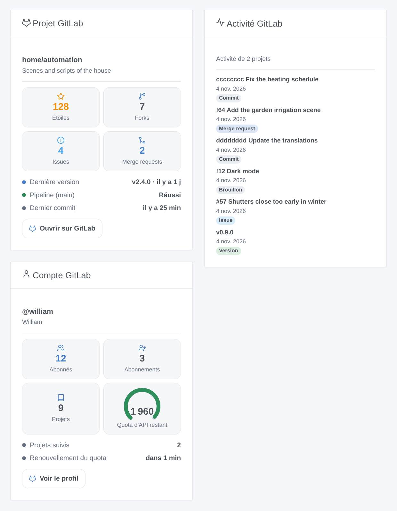

# GitLab

## Présentation

Cette intégration suit des projets **GitLab** dans Gladys, sur gitlab.com ou sur votre propre GitLab auto-hébergé : leurs versions, issues, merge requests, pipelines et étoiles deviennent des appareils, des déclencheurs de scène et des widgets. Elle lit l’API REST v4 officielle de GitLab avec un jeton d’accès en lecture seule, et n’écrit jamais dans GitLab.

Chaque projet suivi devient un appareil, à côté d’un appareil pour votre compte. Des déclencheurs de scène réagissent à une nouvelle version, issue, merge request, à un nouveau commit ou à une nouvelle étoile, et à la fin du pipeline de la branche par défaut.

GitLab est une marque de GitLab Inc. Cette intégration n’est pas affiliée à GitLab.

## Prérequis

- Gladys Assistant 5.3.0 ou plus récent.
- Un compte sur gitlab.com ou sur un GitLab auto-hébergé.
- Un jeton d’accès avec la portée `read_api` : dans GitLab, ouvrez **Préférences → Jetons d’accès**, ajoutez un jeton, cochez seulement **read_api** et copiez-le. Un jeton d’accès de groupe ou de projet avec `read_api` convient aussi.

## Configuration

| Champ                        | Rôle                                                                                               |
| ---------------------------- | -------------------------------------------------------------------------------------------------- |
| Adresse de l’instance GitLab | https://gitlab.com par défaut, ou l’adresse de votre GitLab auto-hébergé.                          |
| Jeton d’accès                | Le jeton avec la portée `read_api`.                                                                |
| Projets à suivre             | `groupe/projet` (sous-groupes compris) ou son lien ; `groupe/*` et `groupe/préfixe*` ; 30 au plus. |
| Intervalle de lecture (s)    | 60 à 3 600 secondes, 120 par défaut ; c’est aussi le délai des déclencheurs.                       |
| Langue des textes            | Noms des appareils, résumés et sorties des scènes ; automatique par défaut.                        |

Enregistrez, puis appuyez sur **Tester la connexion** : le résultat nomme le compte du jeton et dit combien de projets ont été lus.

## Utilisation

### Appareils

Dans **Découverte**, créez l’appareil « GitLab @utilisateur » (abonnés, abonnements, projets) et un appareil « GitLab groupe/projet » par projet : étoiles, forks, issues ouvertes, merge requests ouvertes et fusionnées, dernière version, tag, commit, issue et merge request, et le pipeline de la branche par défaut (Réussi, Échoué, Annulé, En cours).

### Déclencheurs de scène

Tous filtrent par projet (laissez vide pour tous) :

- **Version publiée** : une version à venir compte à sa date.
- **Issue ouverte**, **Merge request ouverte** (variable `draft`).
- **Nouveau commit** sur la branche par défaut.
- **Nouvelle étoile**.
- **Pipeline terminé** : réussi, échoué ou annulé (filtre : résultat).

Chaque événement donne le projet, l’élément (numéro, titre, auteur, lien) et une phrase `summary`. La première lecture après un démarrage ou un nouveau jeton sert de référence : rien ne se déclenche.

### Action de scène

**Lire un projet** donne ses compteurs, sa dernière version et son dernier commit, son pipeline et une phrase `summary`. Un compteur inconnu vaut -1.

### Widgets

- **Projet GitLab** : étoiles, forks, issues, merge requests, dernière version, pipeline, dernier commit, un lien.
- **Activité GitLab** : les dernières versions, issues, merge requests et commits de tous les projets (ou d’un seul), du plus récent au plus ancien.
- **Compte GitLab** : abonnés, abonnements, projets, et le quota d’API restant sur gitlab.com.

## Dépannage

- **« GitLab a refusé le jeton »** : le jeton est erroné, expiré ou révoqué : créez-en un nouveau.
- **« GitLab a refusé l’accès avec ce jeton »** : il manque au jeton la portée `read_api`.
- **« Introuvables ou invisibles pour le jeton »** : vérifiez le chemin (`groupe/sous-groupe/projet`), et que le jeton voit le projet (un projet privé demande le jeton d’un membre).
- **« GitLab est injoignable à cette adresse »** : vérifiez l’adresse de votre instance, et que Gladys peut la joindre.
- **Pas de pipeline ni de merge requests** : le projet les a désactivés, ou n’a pas encore de pipeline sur sa branche par défaut ; ces fonctionnalités sont simplement laissées de côté.
- Signalez un problème avec les versions de Gladys et de l’intégration et ses journaux ; ne collez jamais votre jeton.
